<div align="center">

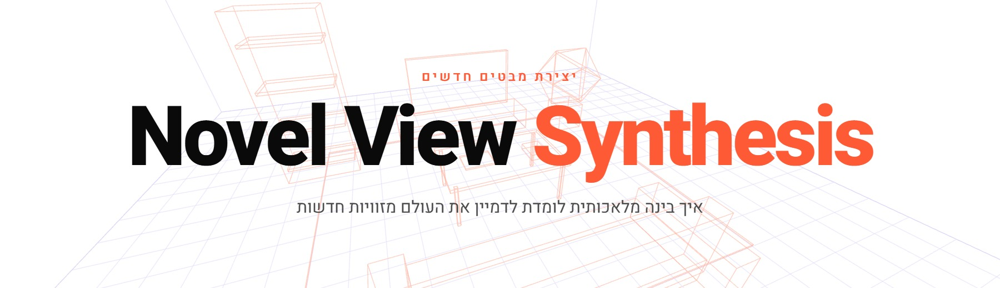

### How machines learn to see a scene from angles nobody photographed.

A 20-minute seminar talk on novel view synthesis, built as an interactive web deck
instead of slides. It goes from classical 3D reconstruction through SRN and NeRF to
3D Gaussian Splatting, and nearly every step is a live animation you click, drag or
hold instead of a bullet point.

<a href="https://novelviewsynthesis.vercel.app"></a>


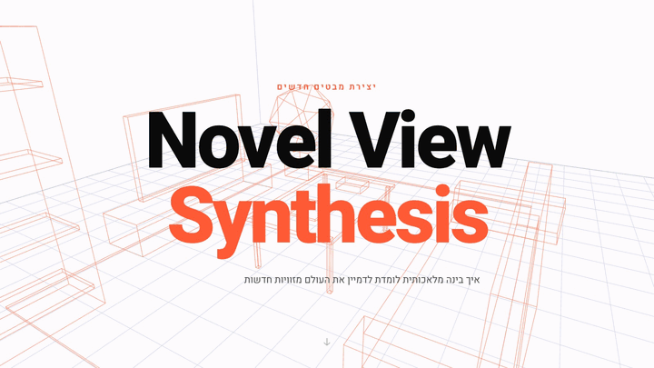

<i>Recorded straight from the running deck (sped up to fit): the problem, Structure
from Motion, the NeRF pipeline, SRN vs NeRF, the Gaussian Splatting pipeline and the
take-home message.</i>

</div>

---

## What it is

Twenty full-screen slides, written in Hebrew for a computer-science audience, that
answer one question: *given a handful of photos, how do you render the scene from a
viewpoint no camera ever stood at?*

The deck is plain HTML, CSS and ES modules, with no framework and no build step.
Three.js draws the WebGL scenes. Everything else (the NeRF pipeline, the
Gaussian Splatting pipeline, the neural-network diagram, the point clouds) is drawn
frame by frame on 2D canvases, with its own projection math. The 3D objects inside
those animations are real: point clouds and Gaussian splats reconstructed offline from
the NeRF synthetic dataset's training photos and baked to JSON.

The two pipeline slides never auto-play. They move one step per click, so the talk
runs at the speaker's pace.

## The problem

<table>
<tr>
<td width="50%">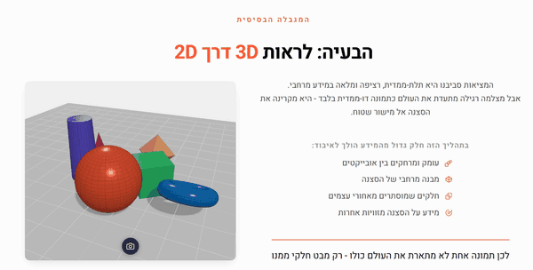</td>
<td width="50%">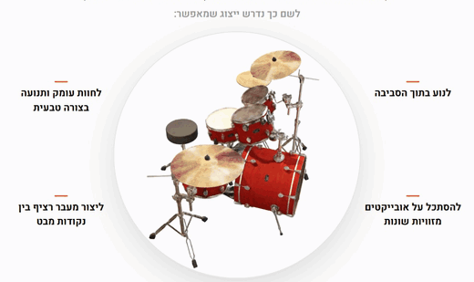</td>
</tr>
<tr>
<td align="center"><b>Seeing 3D through 2D.</b> A small Three.js scene you can drag
to orbit. Press the camera button and the view flashes and drops out as a polaroid
labelled "2D image". Depth, hidden sides and every other angle are gone.</td>
<td align="center"><b>From a photo to a space.</b> Click the orb to step through three
phases: photos of a drum kit from 20 angles, the dome of cameras that took them, and a
smooth rendered orbit you could never get from the photos alone.</td>
</tr>
</table>

Before that, slide 2 sets the stakes: VR and AR, games, robotics, autonomous cars,
digital twins and spatial computing, each with its own animated icon over a moving
horizon grid.

## Before learning: classical 3D

<div align="center">
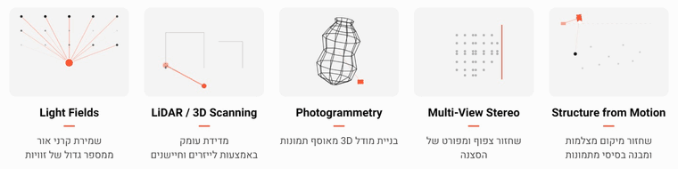
<br>
<i>Five live canvases, one per classical approach: Structure from Motion, Multi-View
Stereo, Photogrammetry, LiDAR and Light Fields.</i>
</div>

<table>
<tr>
<td width="50%">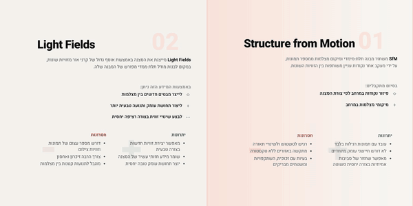</td>
<td width="50%">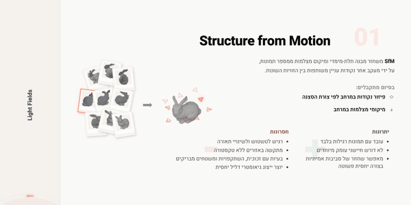</td>
</tr>
<tr>
<td align="center"><b>Structure from Motion.</b> Press and hold a panel for half a
second to open it. Nine photos of the Stanford Bunny fly into one model, and the camera
positions are recovered around it.</td>
<td align="center"><b>Light Fields.</b> A ring of cameras, a strip of captured views,
and new "virtual camera" views interpolated between them. It works, but only as long as
you stay close to the cameras you have.</td>
</tr>
</table>

<table>
<tr>
<td width="34%" align="center">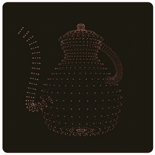</td>
<td width="66%">

**Why that wasn't enough.** These methods could reconstruct geometry, but turning it
into a believable experience exposed the limits: continuous motion between views,
regions no camera saw, glass, lighting and reflections, real-time viewpoint changes,
and a natural sense of depth. A model of the shape alone isn't enough to render the
look.

The teapot is a real point cloud, generated from the classic Utah Teapot's surfaces.

</td>
</tr>
</table>

## The learning era

<div align="center">
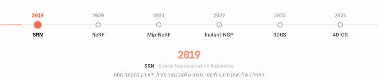
<br>
<i>After defining novel view synthesis, the deck walks a timeline by itself: SRN (2019),
NeRF (2020), Mip-NeRF (2021), Instant-NGP (2022), 3DGS (2023) and 4D-GS (2024), one
milestone every seven seconds.</i>
</div>

## SRN · Scene Representation Networks

<table>
<tr>
<td width="50%">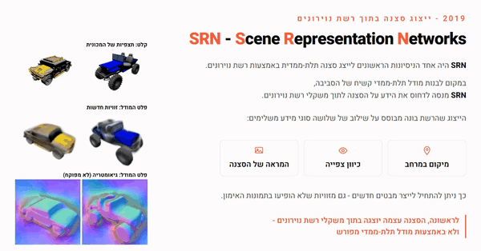</td>
<td width="50%" valign="top">

**A scene inside a network (2019).** SRN was one of the first attempts to store a
whole 3D scene in a neural network's weights instead of an explicit model. The slide
plays SRN's own results: the input observations of a car, the novel views it renders,
and the geometry it learned without supervision.

The slide after it weighs it up: it renders unseen angles and learns structure on its
own, but it needs training per scene and the output stays blurry.

</td>
</tr>
</table>

<div align="center">
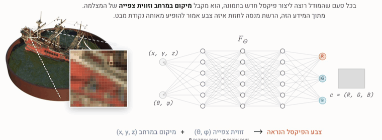
<br>
<i>How SRN makes a new image: a position (x, y, z) and a viewing direction (θ, φ) go
into the MLP F<sub>Θ</sub>, and out comes the colour of that pixel. Do it for every
pixel and you have the scene from a new angle.</i>
</div>

## NeRF · Neural Radiance Fields

<div align="center">
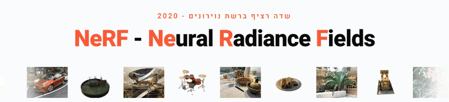
<br>
<i>An endless strip of NeRF results (seven videos, seven GIFs) under the explanation:
NeRF predicts density σ as well as colour, so the samples along a ray can be blended
into one pixel.</i>
<br><br>
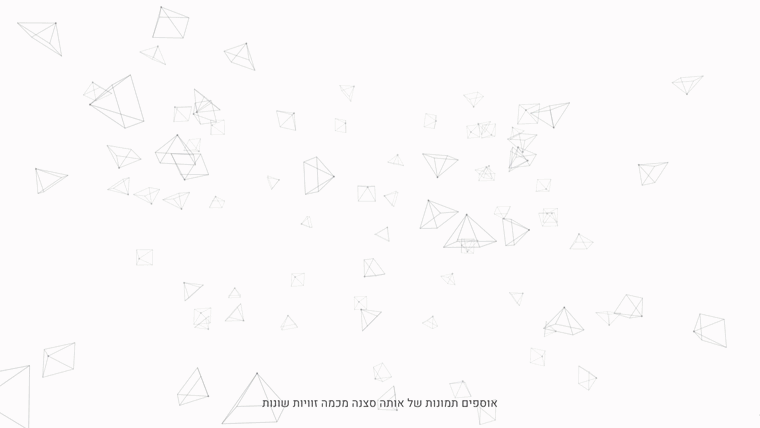
<br>
<b>The NeRF pipeline, one click per chapter.</b>
<br>
<i>A canvas recreation of Matthew Tancik's NeRF explainer. 96 cameras drift and settle
on a dome, one fires a ray, 22 samples appear along it, each (x, y, z, θ, φ) goes
through F<sub>Θ</sub> and comes back as (RGB, σ), and the samples collapse into one
pixel. The last clicks pull back, fire rays from every camera and leave the
reconstructed bulldozer, a real 40,000-point cloud built from the Lego scene's training
views.</i>
</div>

<table>
<tr>
<td width="50%">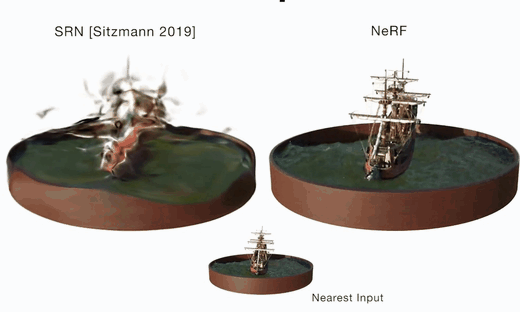</td>
<td width="50%" valign="top">

**Same scene, two models.** SRN and NeRF render the same ship from the same moving
camera. NeRF is sharp and full of detail; SRN stays smeared.

Just before it, NeRF's costs: long training, slow rendering, many network queries
along every ray, and no real-time viewing. That's the opening for what comes next.

</td>
</tr>
</table>

## 3D Gaussian Splatting

<div align="center">
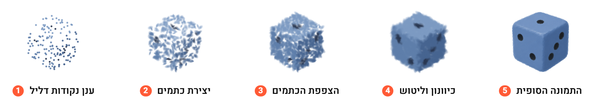
<br>
<i>The same die at five stages: sparse point cloud, first splats, densification,
refinement, final render. Each splat stores a position, a shape and size, a colour and
an opacity.</i>
<br><br>
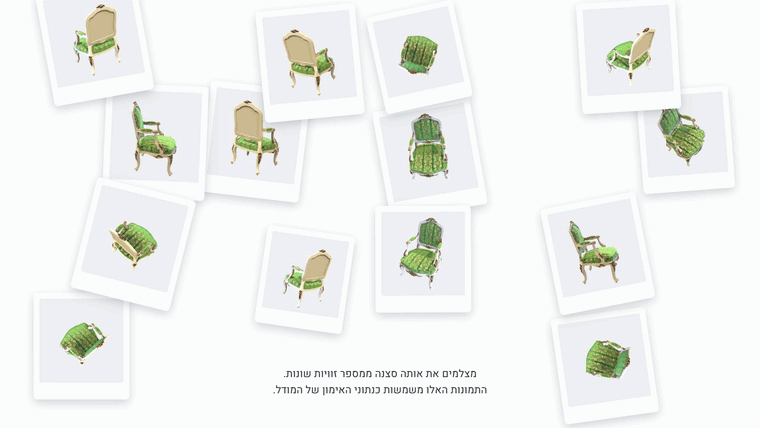
<br>
<b>How 3DGS builds a scene, step by step.</b>
<br>
<i>Seven clicks on the NeRF chair: 16 real training photos as polaroids, the sparse
point cloud recovered from them, every point turned into an oriented Gaussian, a
training render from one camera pose, the comparison with the real photo
(L = Σ‖render − real‖²), the Gaussians being cloned, split and pruned, and the trained
chair you can view from anywhere.</i>
</div>

<table>
<tr>
<td width="50%">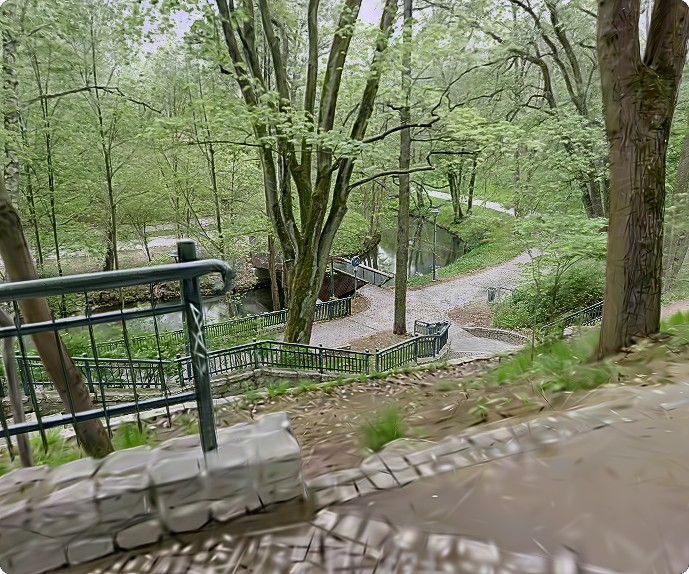</td>
<td width="50%" valign="top">

**Continuous vs discrete.** Two live tours side by side, both embedded in the slide.
On one side, a Gaussian-splat capture from SuperSplat that you can move through
freely. On the other, a Matterport tour that jumps between fixed photo positions.

Same goal (walking through a real place), very different feel: the splat fills in the
views between captures, so motion stays smooth.

</td>
</tr>
</table>

## Take-home message

<table>
<tr>
<td width="50%">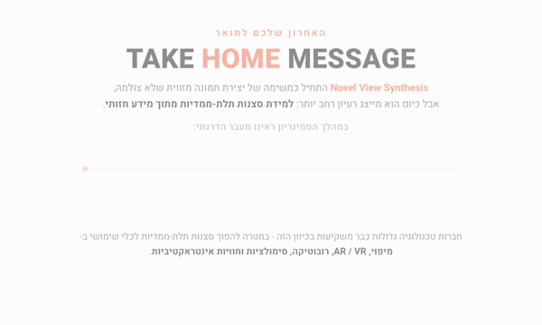</td>
<td width="50%" valign="top">

The evolution rail lights up one stage at a time: explicit geometry, neural scene
representations, continuous fields of colour and density, and real-time splats. Then
the companies already investing in the field: NVIDIA, Google, Niantic, Meta and Snap.

One click swaps to the closing question: *if any collection of photos could become a
living 3D environment, how would that change the way we learn, work and experience the
world?*

</td>
</tr>
</table>

## Presenting it

| Input | Action |
| --- | --- |
| Scroll wheel, <kbd>↓</kbd> / <kbd>↑</kbd>, <kbd>Page Down</kbd> / <kbd>Page Up</kbd>, <kbd>Space</kbd> | Next / previous slide |
| <kbd>Home</kbd> / <kbd>End</kbd> | First / last slide |
| Swipe up / down | Next / previous slide on touch screens |
| Dots on the side | Jump to any slide |
| Drag the scene, then the camera button (slide 3) | Orbit, then capture it as a 2D photo |
| Click the orb (slide 4) | Next phase: photos, camera dome, rendered orbit |
| Press and hold a panel (slide 6) | Open SfM or Light Fields. The arrow or the collapsed tab goes back |
| Click anywhere (slides 13 and 17) | Advance the pipeline one step |
| Click anywhere (slide 19) | Switch between the companies and the closing question |

Deep links open the deck on a specific slide: `#nerf`, `#nerf-pipeline`,
`#srn-nerf-compare`, `#gaussian-splatting` and `#gaussian-pipeline`.

<details>
<summary><b>All 20 slides</b></summary>
<br>

| # | Slide | On screen |
| --- | --- | --- |
| 1 | Novel View Synthesis | Wireframe room in Three.js |
| 2 | The spatial shift | Six domains with animated icons over a moving horizon grid |
| 3 | The problem: 3D through 2D | Orbit a 3D scene and photograph it |
| 4 | From a photo to a space | Three-phase orb: photos, camera dome, rendered orbit |
| 5 | Classical approaches | Five live canvases |
| 6 | SfM vs Light Fields | Hold-to-open split, Stanford Bunny |
| 7 | Why classical methods weren't enough | Utah Teapot point cloud |
| 8 | Into novel view synthesis | Self-playing model timeline, 2019 to 2024 |
| 9 | SRN | SRN's results: inputs, novel views, learned geometry |
| 10 | How SRN makes a new image | One pixel through the MLP |
| 11 | SRN: pros and cons | |
| 12 | NeRF | Endless results carousel |
| 13 | The NeRF pipeline | Click-driven, 11 chapters |
| 14 | NeRF: pros and limits | |
| 15 | SRN vs NeRF | Same scene, side by side |
| 16 | 3D Gaussian Splatting | Five-stage die |
| 17 | The 3DGS pipeline | Click-driven, 7 steps on the NeRF chair |
| 18 | Discrete vs continuous | Live SuperSplat and Matterport embeds |
| 19 | Take-home message | Evolution rail, companies, closing question |
| 20 | Thank you | Presenters |

</details>

## How it works

Each part folds open: the slide lifecycle, the click-driven pipelines, the volume
rendering the NeRF slide illustrates, and where the 3D data comes from.

<details>
<summary><b>Slide lifecycle and the render loop</b></summary>
<br>

```text
scroll / key / swipe ─▶ goTo(i) ─▶ IntersectionObserver (≥ 55% visible) ─▶ currentIdx
                                                       │
                       first visit: init() from sceneRegistry ─▶ enter() on every visit
                                                       │
            one requestAnimationFrame loop ─▶ tick(visible, dtScale) for every live scene
```

- Every slide is a full-viewport `<section class="slide" data-id="N">`. The
  `IntersectionObserver` in `js/app.js` makes a slide current once 55% of it is on
  screen and uses `data-id − 1` as its index, so `data-id` has to match DOM order.
- Animated slides are registered by index in `sceneRegistry`. Their initialisers run
  the first time the slide is reached (slides 1–4 at load), and `enter()` fires on
  every re-entry so click-driven slides start from step one.
- A single `requestAnimationFrame` loop ticks every scene, but only the current slide
  and its two neighbours actually draw.
- Frame-based motion is multiplied by `dtScale = Δt × 60` (with Δt capped at 0.1 s),
  so animations run at the same speed on 60, 120 and 144 Hz screens.
- The scroll wheel is locked for 650 ms after each move, so one flick never skips two
  slides.

</details>

<details>
<summary><b>Click-driven pipelines (slides 13 and 17)</b></summary>
<br>

**The NeRF pipeline** (`initNeRFVideo` in `js/slides.js`) is one long timeline cut
into 11 chapters. A chapter plays to its end frame and pauses there with its caption.
A click only counts while paused, so you can't skip half a chapter, and the final
chapter is a dead end: it never loops back to the start in front of an audience.

```text
cameras drift ─▶ settle on a dome ─▶ close-up, ray, 22 samples ─▶ F_Θ appears
  ─▶ samples queried one by one ─▶ every sample gets (RGB, σ) ─▶ one pixel
  ─▶ pull back to all cameras ─▶ every camera fires rays ─▶ only the model remains
```

**The 3DGS pipeline** (`js/gpipe.js`) has seven steps. A click raises a `target` step
(with a 3-second cooldown against double clicks), and a smoothed `flow` value eases
toward it. Every visual is a function of `flow`, so each step morphs into the next
instead of cutting, and the caption is the step at `round(flow)`.

`gpipe.js` has no Three.js dependency. It projects and blends the splats itself on a
2D canvas.

</details>

<details>
<summary><b>What the NeRF slide is illustrating (volume rendering)</b></summary>
<br>

NeRF learns a function F<sub>Θ</sub>(x, y, z, θ, φ) → (RGB, σ). To render a pixel,
cast a ray **r**(t) = **o** + t·**d** from the camera through it, sample points
t<sub>1</sub> … t<sub>N</sub> along the ray, query the network at each one, and
composite front to back:

```text
C(r) = Σᵢ Tᵢ · (1 − exp(−σᵢ · δᵢ)) · cᵢ        Tᵢ = exp(−Σⱼ<ᵢ σⱼ · δⱼ)        δᵢ = tᵢ₊₁ − tᵢ
```

`Tᵢ` is how much light survives to sample `i`, so dense samples near the camera hide
the ones behind them. Training compares `C(r)` with the real pixel colour for rays from
every training photo and backpropagates the squared error.

The animation shows exactly that path with 22 samples: most come back nearly
transparent, a few on the surface come back dense and coloured, and together they
collapse into the pixel's final colour.

</details>

<details>
<summary><b>The 3D data is real</b></summary>
<br>

- **The bulldozer** (slide 13) is `assets/generated/lego_points.json`: 40,000 coloured
  points reconstructed offline as a visual hull from the Lego scene's training views,
  then drawn with the slide's own projector so it rotates with the camera.
- **The chair** (slide 17) is `assets/generated/chair_splats.json`: 40,000 oriented,
  coloured splats (`pos`, `col`, `nrm`, `spc`) carved from the chair's training
  photos and camera poses. `densify_chair_splats.py` grew it from 5,200 splats by
  scattering sub-splats inside each one's tangent footprint.
- **The polaroids** on slide 17 are the chair's real training images, and the final
  step overlays the real NeRF render as an ``. Drawing a GIF onto a canvas freezes
  it on one frame, so it stays a DOM element.
- **The Stanford Bunny** (slide 6) is rendered from 9 angles plus a 36-frame rotation
  by `generate_bunny_renders.py`.
- **The Utah Teapot** (slide 7) is built by `generate_teapot_particles.py` from a
  surface of revolution for the body and Bézier tubes for the handle and spout.
- **The die** (slide 16) is 1,800 master splats on the three visible faces of a 2:1
  isometric cube. Each panel reveals a random subset of that one set, so the same
  object densifies from panel to panel.

</details>

<details>
<summary><b>Hold to open (slide 6)</b></summary>
<br>

Holding a panel charges it at 1/30 per frame (about half a second at 60 Hz). Letting
go drains it faster, at 1/25, so a stray click never opens anything. At full charge
the panel expands and the other one collapses into a thin tab. Clicking the tab or the
arrow resets the split. Only the open side's canvas animates.

</details>

## Run it locally

ES modules don't load over `file://`, so serve the folder with any static server:

```bash
python -m http.server 8000
# then open http://localhost:8000
```

- Three.js is loaded from unpkg through an import map, and slide 18 embeds two
  external tours, so the deck needs an internet connection.
- The `.mp4` files are stored with Git LFS. After cloning, run `git lfs pull`.
- The live version is a static deploy on Vercel.

## Offline asset pipeline

The scripts under `scripts/` generate the deck's 3D data. Install with
`pip install -r scripts/requirements.txt`.

| Script | What it produces | Used on |
| --- | --- | --- |
| `generate_bunny_renders.py` | Stanford Bunny: 9 polaroid renders and a 36-frame rotation sprite | Slide 6 |
| `generate_teapot_particles.py` | Utah Teapot point cloud (loaded as `limits_model.json`) | Slide 7 |
| `densify_chair_splats.py` | Grows the chair from 5,200 to 40,000 splats | Slide 17 |
| `generate_limits_model.py` | A round-brilliant diamond point cloud | Earlier version of slide 7 |
| `generate_particles.py` | Bunny RGB + depth sampled into a particle cloud | Earlier Light Fields animation |
| `generate_single_image_pipeline.py` | Depth Anything V2 depth, forward splatting and LaMa inpainting from one photo | Earlier single-image section |
| `render_novel_view.py` | Depth-warped and inpainted novel view of the red Toyota | Earlier single-image section |
| `render_orbit_view.py` | Zero123++ orbit view of the red Toyota | Earlier single-image section |

## Code map

| Path | What it does |
| --- | --- |
| `index.html` | All 20 slides, the import map and the deck chrome (progress bar, dots, counter) |
| `css/styles.css` | The whole design: Heebo / Inter, the orange accent, every slide's layout |
| `js/app.js` | Navigation, visibility tracking, lazy slide setup and the render loop |
| `js/slides.js` | One initialiser per animated slide, including the NeRF pipeline |
| `js/gpipe.js` | The click-driven 3D Gaussian Splatting pipeline (slide 17) |
| `assets/generated/` | Baked point clouds and splats, bunny renders |
| `assets/3dgs/`, `assets/nerf/`, `assets/srn/` | NeRF synthetic scenes, result clips and paper material |
| `scripts/` | Offline asset pipeline (see above) |
| `docs/` | Source lecture slides and planning notes |
| `media/` | The images and GIFs in this README |

`js/depth.js`, `js/upload.js`, `js/userImage.js`, `js/views.js` and `js/scene.js`
belong to an earlier single-image section (an in-browser depth model and photo
upload). The current 20-slide deck doesn't load them.

## Notes

- Designed for a 16:9 screen with a mouse or trackpad. Touch navigation works, but the
  hold and drag interactions are built for a presenter at a laptop.
- Slides 1, 3, 4 and 20 need WebGL. The rest are 2D canvas, CSS and video.
- The NeRF result GIFs in `assets/nerf/` are roughly 20–70 MB each, so the first pass
  through the deck on a slow connection takes a while. Running it from a local server
  before a talk avoids that.
- The Matterport tour on slide 18 is a third-party embed and can show a bot check in
  automated or private browsers.

## Credits

Presented by Yaala Rosenzweig, Amit Shaar and Sean Fourman.

- **NeRF:** Mildenhall, B. et al. (2020). *NeRF: Representing Scenes as Neural
  Radiance Fields for View Synthesis.* ECCV. The results carousel, the synthetic scenes
  (chair, Lego, ship, drums and more) and the SRN vs NeRF comparison come from the
  authors' published material. Slide 13 recreates Matthew Tancik's NeRF explainer
  video.
- **SRN:** Sitzmann, V., Zollhöfer, M. & Wetzstein, G. (2019). *Scene Representation
  Networks.* NeurIPS. Slide 9 plays the authors' results.
- **3D Gaussian Splatting:** Kerbl, B. et al. (2023). *3D Gaussian Splatting for
  Real-Time Radiance Field Rendering.* ACM TOG (SIGGRAPH).
- **Stanford Bunny:** The Stanford 3D Scanning Repository. **Utah Teapot:** Martin
  Newell, rebuilt here from parametric surfaces.
- **Live tours:** [SuperSplat](https://superspl.at) and [Matterport](https://matterport.com).
- Company logos on slide 19 belong to their owners. Fonts: Heebo, Inter and JetBrains
  Mono from Google Fonts.
